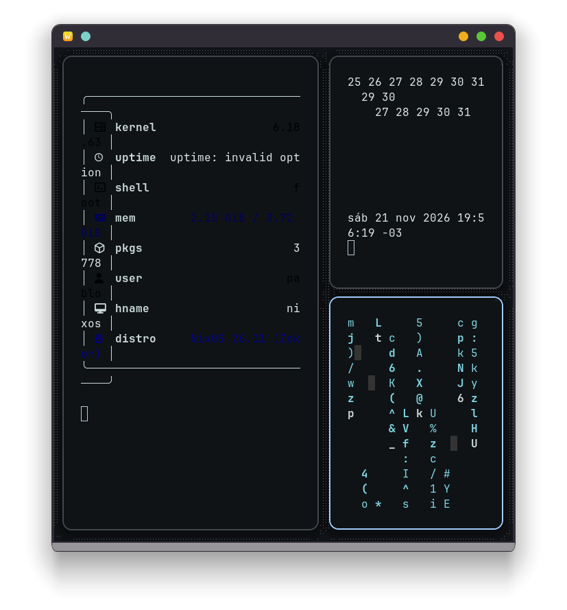
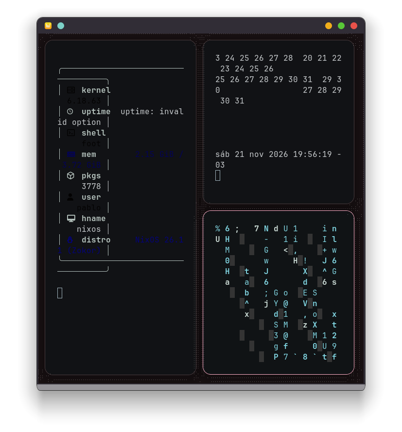
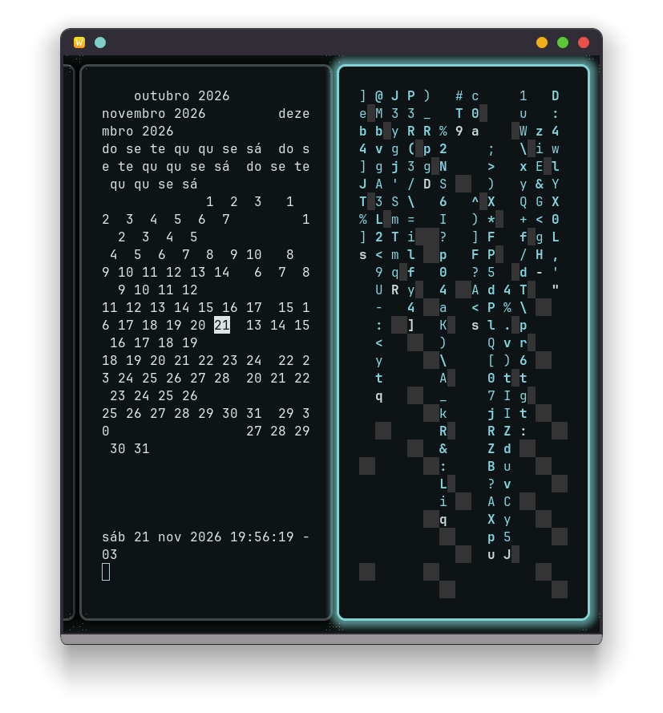
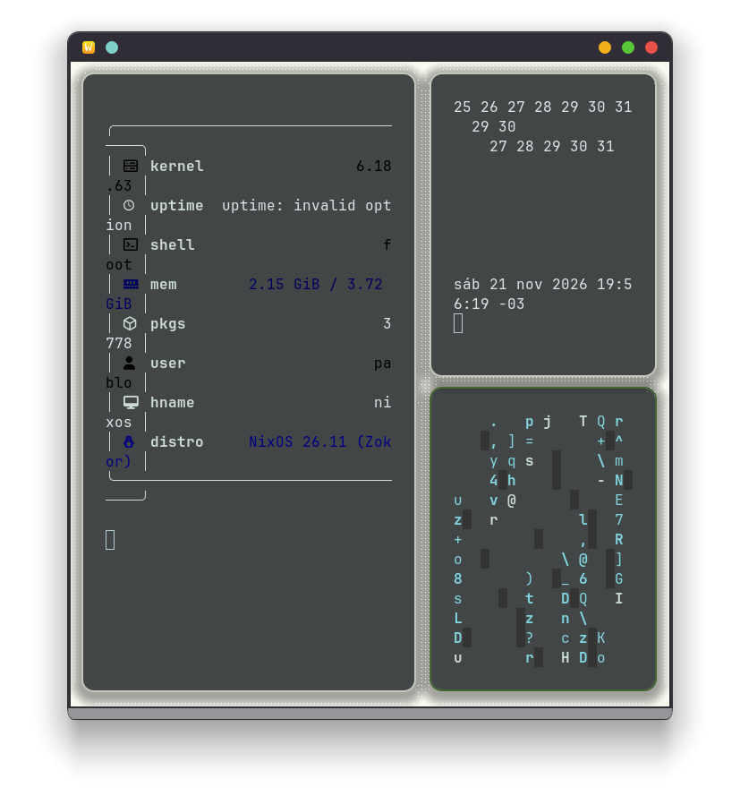

<div align="center">

# VEYRON WM

**A light, good-looking tiling Wayland compositor written in Rust.**

Scrollable columns like niri, master-stack and dwindle like Hyprland,
Material You colours generated from one seed, GPU rounded corners and shadows,
and a JSON control socket for bars and scripts. It runs well on a 4 GiB netbook.

[](https://github.com/pabl0conepc-alt/Veyron-WM/actions/workflows/ci.yml)


</div>

| `material`, master-stack | `glass`, dwindle |
|---|---|
|  |  |
| **`neon`, scrolling columns** | **light mode** |
|  |  |

<sub>Real screenshots: Veyron running nested in KDE Plasma on an Intel HD
Graphics 3000 netbook, with `foot` terminals. Every style and colour above was
switched at runtime with `veyronctl theme …`.</sub>

## Highlights

- **Layouts:** endless scrolling columns, master-stack, dwindle, grid,
  center-tile, deck, monocle, floating workspaces and `auto` (chosen from the
  window count), per workspace; floating windows, fullscreen, scratchpad, snap
  zones, picture-in-picture and window groups.
- **Looks:** five designs (`material`, `glass`, `flat`, `neon`, `minimal`) drawn
  on the GPU with rounded corners, rounded borders and soft shadows; server-side
  decorations, so apps do not draw their own title bars.
- **Material You:** one seed colour or preset generates the whole scheme, which
  colours window borders and is exported for waybar, GTK and eww. Dark/light,
  nine variants and contrast are switchable live.
- **Workspaces:** on-demand, named, persistent and special workspaces on a 2D
  grid, with an overview and per-monitor workspaces in the core.
- **Easy to configure:** one strict TOML file, reloaded automatically when you
  save it; `veyron --check-config` explains mistakes.
- **Scriptable:** `veyronctl` for every action, `veyronctl watch --waybar` and
  `veyronctl subscribe` push changes to bars instantly, session save/restore, app launcher and profiles.

## Quick start

```sh
git clone https://github.com/pabl0conepc-alt/Veyron-WM
cd Veyron-WM
./install.sh
```

The installer detects NixOS, Arch, Debian/Ubuntu and Fedora, installs the
dependencies (asking before `sudo`), gets Rust 1.97+ through rustup when the
system one is older, builds with one job on machines with less than 6 GiB of
RAM, installs `veyron` and `veyronctl` into `~/.local/bin` and writes a
starter configuration to `~/.config/veyron/veyron.toml`. Run it again to
update; `./install.sh --uninstall` removes the binaries.

Then, from inside your current desktop:

```sh
veyron
```

| Do this | Press |
|---|---|
| Open a terminal (`$TERMINAL`, foot, kitty, …) | `super+return` |
| Close a window | `super+q` |
| Move focus / move the window | `super+arrows` / `super+shift+arrows` |
| Next layout | `super+shift+l` |
| Switch workspace / send the window there | `super+1..5` / `super+shift+1..5` |
| Alt-tab | `alt+tab` |
| Float a window, then drag it | `super+space`, `super+left drag` |
| Resize a floating window | `super+right drag` (grab near an edge or corner) |
| Next design / dark-light / next colour | `super+alt+t` / `super+t` / `super+shift+t` |
| Quit | `super+shift+e` |

All chords are listed under [Running](#running) and can be changed in the
configuration.

### Make it yours

```toml
# ~/.config/veyron/veyron.toml (saved changes apply immediately)
[theme]
seed = "ocean"        # or any #rrggbb
mode = "dark"
design = "glass"

[layout]
gap = 10
mode = "master-stack"
```

For a matching bar, copy [`contrib/waybar`](contrib/waybar) to
`~/.config/waybar/`: it shows Veyron's workspaces and layout through
`veyronctl watch --waybar` and recolours itself whenever the theme changes.

## Status

The window-management core and the headless protocol path are tested in CI,
and the nested GLES renderer, rounded corners, shadows and server-side
decorations have been checked on screen in a KDE Plasma session on Intel HD
Graphics 3000. Veyron is **not** a finished desktop yet: it runs nested inside
an existing session, and there is no DRM/KMS backend.

See [the phase roadmap](ROADMAP.md) for verified behavior and remaining work.

What works:

- Rust workspace with three crates and no `unsafe` code.
- Scrollable tiling engine: columns, stacking, focus, viewport scrolling,
  column resizing, floating layer, fullscreen, on-demand workspaces.
- Additional tiling layouts: `master-stack`, `dwindle`, `grid`,
  `center-tile`, `deck`, `monocle`, `floating` and `auto` (dynamic tiling that
  resolves from the window count), selectable per workspace; see
  [Layouts](#layouts).
- Smart gaps, per-application window rules (float, opacity, blur, animation,
  scratchpad, named workspace, layout), scratchpad layer and per-app floating
  geometry memory.
- Snap zones (`snap left`, `snap center-third`, `snap maximize`, ...) and
  picture-in-picture docking (`pip top-right`), both on the focused window.
- Window groups: `group` adds the focused window to the previous window's group
  and keeps members adjacent, `group next`/`group prev` cycle inside it.
- Smart focus: `focus previous` returns to the last focused window.
- Multi-output policy: outputs are registered and unplugged at runtime
  (`Wm::add_output` / `remove_output`), each with its own workspaces and
  viewport; `output <direction>` moves focus to the monitor in that direction,
  `move-output <direction>` sends the focused window there and
  `workspace-output <direction>` takes the whole active workspace along.
  `Wm::snapshots()` returns one frame description per output.
- Veyron Profiles: named presets that patch only the layout and motion fields
  they set, applied at startup with `default_profile` and at runtime with
  `profile <name>`; `profile next` / `profile prev` cycle them in configuration
  order (bound to `super+p` by default). A profile that would leave the
  configuration invalid is refused instead of partially applied.
- Veyron Recall: `Wm::capture_session` / `restore_session` serialise the session
  (workspaces, windows with their announced app id and title, floating geometry)
  to TOML. `veyronctl session save FILE` captures it over IPC, and
  `veyronctl session restore FILE` restores policy state; it does not launch
  applications.
- Window identity: the app id and title a client announces on its first commit
  reach the core, so rules, opacity, Recall and `veyronctl state` use the real
  metadata instead of empty strings.
- Animation foundation: a `spring` and eased `RectAnimator` that integrate a
  `dt` supplied by the caller, plus duration and reduced-motion policy. The
  nested scene graph now interpolates window positions and schedules frames
  until transitions finish; motion is off by default. XDG client sizes still
  configure at their target, and no visual nested-session check has been
  recorded yet.
- Per-window motion policy: `[[rules]] animation = false` snaps one
  application's transitions, and switching workspaces slides the new one in
  from the direction the user travelled.
- Persistent workspaces: `[[workspaces]]` creates named workspaces with an
  optional grid position and layout at startup; `workspace special` toggles a
  scratch workspace and returns to the workspace it was opened from.
- Application launcher: `veyronctl launch <NAME>` resolves an installed XDG
  desktop entry by name or id, refuses entries that need a terminal, and starts
  the rest directly without a shell.
- Workspace overview: `Wm::overview` lays every workspace on the sparse grid and
  scales each workspace's windows into its tile; `veyronctl overview [--json]`
  exposes it for bars, scripts and a future overview surface.
- Layer-shell: `zwlr_layer_shell_v1` clients (waybar, notification daemons,
  wallpapers, OSDs, launchers) are mapped on the output and get frame
  callbacks and pointer input; their exclusive zones keep tiled and floating
  windows clear of them (fullscreen still covers the whole output), and a
  launcher asking for exclusive keyboard interactivity holds the keyboard
  while it is open.
- Smart workspace: with `behavior.smart_workspace`, every window the core places
  teaches it where that app lives, and its next window opens on the same output
  and workspace without switching the user away. Rules still win.
- Veyron Canvas: `canvas <dx> <dy>` moves every floating window of the workspace
  together, stopping each one at the output edge.
- Deterministic, unit-tested state machine (122 core tests plus integration
  tests) with no GPU or display server required.
- TOML configuration with strict validation and a documented default keymap.
- Versioned line-delimited JSON control protocol on a Unix socket
  (`veyronctl`) with request/response, size limits and stale-socket handling,
  plus `veyronctl subscribe`: a pushed event stream (`workspace`, `focus`,
  `windows`, `layout`, `theme` changes with the new state) for bars and shells.
- Pointer: `super` + left drag moves and `super` + right drag resizes floating
  windows; client title bars can move/resize them (`xdg_toplevel.move/resize`),
  and F11 / video-player fullscreen requests are honoured.
- Nested (winit) Wayland compositor: `xdg-shell` toplevels, SHM buffers,
  keyboard, pointer, wheel, `wl_output`, popups tracked, tiled layout rendered
  through Smithay's scene graph.
- Headless runtime (`--headless`) that needs no display, GPU or DRM device, and
  end-to-end tests that drive it with a real `wayland-client` connection and
  assert on Veyron's own state: toplevel mapping, configure size against the
  tiling layout, focus and activation, workspace scrolling, and unmap on
  destroy.

Known gaps, deliberately out of this milestone (see `docs/ARCHITECTURE.md`):

- No DRM/KMS backend or session management; Veyron currently runs nested
  inside an existing session and still binds a single output. The core already
  models several outputs, so the backend only has to report them.
- No cursor image is drawn yet. Only window positions animate: there are no
  opening/closing transitions, and client sizes still jump to their target.
- Popup grabs, screencopy, idle, input-method and session-lock protocols are not
  implemented. Layer-shell keyboard focus and exclusive zones are tested
  headlessly but not yet checked with real bars and launchers.
- Blur is not drawn. On Intel HD Graphics the faint edge of shadows shows a
  slight dotted dithering pattern in the nested window; the `flat` design
  avoids it.

## Building

Requirements: Rust 1.97+ (required by `material-colors`), a C toolchain, `pkg-config`, and the usual EGL/Mesa
development packages. The nested backend needs a running Wayland or X11 session.

```sh
cargo build --release          # builds veyron and veyronctl
cargo test                     # core, IPC and headless protocol suites
```

### Nix

The repository includes a locked Nix flake for `x86_64-linux`. Build it from a
checkout with:

```sh
nix build .#default
./result/bin/veyron --help
nix profile install .#default
```

The package build is also checked by GitHub Actions. The first CI build for this
flake is pending; nested runtime support still needs validation on the target.

### Arch Linux

`packaging/arch/PKGBUILD` builds a `veyron-wm-git` package from the default
branch on GitHub. It runs the full test suite in `check()` and installs
`veyron`, `veyronctl`, the README and a Wayland session file:

```sh
sudo pacman -S --needed base-devel git
cd packaging/arch
makepkg -si
```

To build with plain cargo instead, install the toolchain and the libraries the
compositor loads at runtime (`libwayland-client`, `libxkbcommon` and `libEGL`
are opened with `dlopen`), plus a Mesa driver for the nested renderer:

```sh
sudo pacman -S --needed base-devel rust pkgconf wayland libxkbcommon libglvnd libffi mesa
cargo build --release --workspace --locked
XDG_RUNTIME_DIR="$(mktemp -d)" cargo test --workspace --locked
```

Arch's `rust` package is recent enough for the 1.97 minimum. CI builds the
PKGBUILD with `makepkg` in an `archlinux:latest` container on every push.

The package installs `/usr/share/wayland-sessions/veyron.desktop`, but Veyron
cannot be started from a display manager or a TTY yet: the only backend is the
nested winit one, which needs a running Wayland or X11 session. Start it from
inside your existing desktop as described under [Running](#running).

### Debian and Ubuntu

A `.deb` is built with [`cargo-deb`](https://github.com/kornelski/cargo-deb)
from the metadata in `crates/veyron/Cargo.toml`. Distribution `rustc` packages
are older than the 1.97 minimum, so install the toolchain with
[rustup](https://rustup.rs):

```sh
sudo apt install build-essential pkg-config git curl \
  libwayland-dev libxkbcommon-dev libegl-dev libffi-dev
curl --proto '=https' --tlsv1.2 -sSf https://sh.rustup.rs | sh
cargo install cargo-deb --locked
cargo deb -p veyron --locked
sudo apt install ./target/debian/veyron-wm_*.deb
```

The package installs `veyron`, `veyronctl`, the README and the Wayland session
file, and depends on `libwayland-client0`, `libxkbcommon0`, `libegl1` and
`libffi8` explicitly, because those libraries are opened with `dlopen` and
`dpkg-shlibdeps` cannot see them. The same session-file caveat as on Arch
applies: start Veyron from inside your existing desktop.

CI (`.github/workflows/debian.yml`) runs the test suite, builds the package in
`debian:trixie` and `ubuntu:24.04` containers, installs it with `apt` in a
clean container of the same release and smoke-tests the headless compositor
through `veyronctl`.

## Running

Veyron runs **nested**: it opens a window in your current session and serves a
new Wayland socket to its children.

```sh
# 1. start the compositor
target/release/veyron

# Veyron prints the socket it created; in another terminal:
export WAYLAND_DISPLAY=wayland-1     # use the name printed by veyron
target/release/veyronctl state

# 2. launch a client (any toolkit works)
foot                                  # or any Wayland app
```

Veyron sets `WAYLAND_DISPLAY` for processes it spawns through actions, so
`super+return` starts the terminal from your configuration inside the nested
session.

### Headless

`--headless` runs the same `Display`, protocol handlers and window manager
without a window, GPU or DRM device. It is meant for tests, CI and debugging:
clients connect to a normal Wayland socket and everything except rendering
works.

```sh
target/release/veyron --headless --output-size 1920x1080 \
    --wayland-display veyron-headless
# from another terminal, with XDG_RUNTIME_DIR set the same way:
WAYLAND_DISPLAY=veyron-headless foot
target/release/veyronctl quit
```

`--output-size` sets the logical output size the layout is computed for
(default `1920x1080`). `veyronctl quit` shuts it down cleanly and removes its
control and Wayland sockets.

Default keybindings (all configurable):

| Chord | Action |
| --- | --- |
| `super+return` | open a terminal (`$TERMINAL`, then foot, kitty, alacritty, …) |
| `super+q` | close the focused window |
| `super+left/right/up/down` | focus column / row |
| `super+shift+left/right/up/down` | move window into a column / swap rows |
| `super+minus` / `super+equal` | shrink / grow the focused column |
| `super+alt+arrow` | resize the focused floating window by 32 logical pixels |
| `super+alt+shift+arrow` | move the focused floating window by 32 logical pixels |
| `super+c` | center the focused column |
| `super+f` | toggle fullscreen |
| `super+space` | toggle floating |
| `super+shift+l` | cycle layout (scroll → master-stack → dwindle → auto → grid → center-tile → deck → monocle → floating) |
| `super+p` | apply the next profile (cycles through `[[profiles]]`) |
| `super+shift+s` | send the focused window to / recall it from the scratchpad |
| `super+1` … `super+5` | switch workspace |
| `super+bracketright` / `super+bracketleft` | next / previous workspace |
| `super+ctrl+arrow` | navigate the sparse 2D workspace grid |
| `super+ctrl+shift+arrow` | move the focused window to a neighboring workspace |
| `super+comma` / `super+period` | focus the monitor to the left / right |
| `super+shift+comma` / `super+shift+period` | move the focused window to the left / right monitor |
| `super+ctrl+comma` / `super+ctrl+period` | move the active workspace to the left / right monitor |
| `super+m` | maximize / restore the focused window |
| `super+o` | pin the focused window to every workspace |
| `super+wheel_down` / `super+wheel_up` | next / previous workspace |
| `super+r` | reload the configuration |
| `super+shift+e` | quit |

## Configuration

`$XDG_CONFIG_HOME/veyron/veyron.toml` (or `~/.config/veyron/veyron.toml`).
Veyron starts with built-in defaults when the file does not exist; a file that
exists but is invalid is reported and refused rather than silently ignored.

```sh
target/release/veyron --print-config > ~/.config/veyron/veyron.toml
```

```toml
# Commands started once at launch (root key, before any table):
startup = ["waybar"]
# Profile applied at startup; must exist in [[profiles]] below.
default_profile = "coding"

[layout]
gap = 8                      # pixels between columns and stacked windows
outer_margin = 12            # margin around the tiled area
default_column_ratio = 0.5   # new column width, fraction of the viewport
min_column_ratio = 0.2
max_column_ratio = 1.0
mode = "scroll"              # scroll | master-stack | dwindle | grid |
                             # center-tile | deck | monocle | floating | auto
smart_gaps = false           # 0 gap for one window, tighter when dense
master_ratio = 0.6           # master width in master-stack, deck, center-tile
center_focused_column = "never"  # scroll: never | always | on-overflow

[appearance]
background = "#101014"

# Material You scheme: window borders, and colour files for bars and widgets.
[theme]
seed = "ocean"               # #rrggbb or a preset: material, ocean, forest,
                             # ember, amber, teal, rose, slate
mode = "dark"                # dark | light
variant = "tonal-spot"       # vibrant, expressive, fidelity, content, neutral,
                             # monochrome, rainbow, fruit-salad
contrast = 0.0               # -1.0 (reduced) .. 1.0 (high)
design = "material"          # material, glass, flat, neon, minimal
# Optional overrides of the design's values:
border_width = 2             # 0 disables borders
corner_radius = 12           # 0 keeps square corners
shadow_size = 18             # 0 disables the drop shadow
shadow_opacity = 0.35
inactive_opacity = 1.0       # dim unfocused windows (0.1 .. 1.0)
dim_inactive = 0.0           # darken unfocused windows (0.0 .. 0.9)
# border_active = "#ffb4abff"  # override primary / outline_variant
use_surface_background = true
export = true                # write ~/.local/state/veyron/theme/*

[motion]                     # layout transitions; off by default
enabled = false              # animate retiles and workspace switches
duration_ms = 180
reduce_motion = false        # snap instantly for reduced-motion preferences

[behavior]
remember_geometry = true     # restore floating geometry per app id
smart_workspace = false      # new windows open where their app already lives
focus_follows_mouse = false  # focus the window under the pointer

# Per-application rules, evaluated in order; later fields win.
[[rules]]
app_id = "org.mozilla.firefox"
title = "Picture-in-Picture"
floating = true

[[rules]]
app_id = "mpv"
floating = true
opacity = 0.95
blur = true
animation = false            # do not animate this application

[[rules]]
app_id = "signal"
workspace = "chat"
layout = "dwindle"

# Workspaces that exist when the compositor starts, on the primary output.
# `x`/`y` pin a place on the sparse grid; without them the workspace is appended
# after the existing ones. `workspace special` toggles a scratch workspace.
[[workspaces]]
name = "code"
layout = "dwindle"

[[workspaces]]
name = "chat"
x = 3
y = 0

# Named presets: only the fields listed here are overridden, everything else
# keeps its current value. `profile <name>` applies one at runtime.
[[profiles]]
name = "coding"
[profiles.layout]
gap = 4
mode = "master-stack"
smart_gaps = true
[profiles.motion]
enabled = true
duration_ms = 120

[[profiles]]
name = "cinema"
[profiles.layout]
gap = 24
outer_margin = 32
mode = "scroll"

[bindings]
"super+return" = "spawn foot"
"super+left" = "focus left"
"super+shift+left" = "move left"
"super+f" = "toggle-fullscreen"
```

Rules accept `app_id` and/or `title` globs (`*`, `?`) and may set `floating`,
`opacity` (`0.0..=1.0`), `blur`, `scratchpad`, `workspace` and `layout`. A rule
without a match key is rejected rather than applied to every window.

Profiles accept `name` (required, no whitespace) and `[profiles.layout]` /
`[profiles.motion]` patches. Applying a profile reflows
every workspace on every output, so a margin change is visible immediately;
`mode` also selects that layout for all workspaces. `profile next` / `profile
prev` apply the next or previous entry in configuration order, so `next` and
`prev` are reserved profile names. Duplicate names, an unknown `default_profile`
and patches that violate the layout ratios are configuration errors.

Binding values use the same action grammar as the control protocol, so anything
`veyronctl` can do can be bound to a key. Besides focus/move/workspace actions
there are `snap <zone>` (halves, quadrants, thirds, `center`, `maximize`),
`pip [corner]`, `group`, `group next|prev`, `focus previous` and the monitor
`output <direction>`, `move-output <direction>` and
`workspace-output <direction>` actions. If a `[bindings]` table is present it
replaces the default keymap entirely; omit it to keep the defaults.

Window-management extras borrowed from other compositors:

| Action | Default chord | Does |
|---|---|---|
| `focus-cycle next\|prev` | `alt+tab`, `alt+shift+tab` | cycle through visible windows |
| `move-to-workspace <n>` | `super+shift+1..5` | send the window to workspace n and follow it |
| `center-floating` | `super+shift+c` | center the focused floating window |
| `gaps <±px>` | `super+ctrl+minus/equal` | change the inner gap live (0–64 px) |
| `opacity <±%>` | `super+alt+minus/equal` | change the focused window's opacity (min 10%) |
| `theme toggle` | `super+t` | switch dark/light |
| `theme next` | `super+shift+t` | next preset seed colour |
| `theme variant next` | `super+ctrl+t` | next Material scheme variant |
| `theme seed <#hex\|preset>` | | use a seed colour |
| `theme design next` | `super+alt+t` | next decoration style |
| `theme design <name>` | | `material`, `glass`, `flat`, `neon`, `minimal` |
| `maximize` | `super+m` | fill the usable area (bars stay visible), again to restore; the title bar button does the same |
| `pin` | `super+o` | float the window and keep it on every workspace (Hyprland `pin`, COSMIC sticky) |
| `mark <name>` / `focus-mark <name>` / `unmark [name]` | | name a window and jump back to it from anywhere (sway/i3 marks) |
| `workspace next\|prev` | `super+wheel_down` / `super+wheel_up` | wheel chords: `wheel_up`, `wheel_down`, `wheel_left`, `wheel_right` with any modifiers |

More behaviour from other compositors, all off by default:

```toml
[behavior]
focus_follows_mouse = true   # focus the window under the pointer
cursor_hide_after = 5        # hide an idle pointer after 5 seconds

[theme]
dim_inactive = 0.25          # darken unfocused windows (Hyprland dim_inactive)

[hot_corners]                # GNOME-style corners, any action
top_left = "focus-cycle next"
bottom_right = "spawn foot"
```

The configuration can be split into several files. Paths are relative to the
including file (`~/` is your home); included files are read first and the
including file wins, while `[[rules]]` from every file are kept:

```
# ~/.config/veyron/veyron.toml
include = ["keys.toml", "rules.toml"]
include_optional = ["local.toml"]   # skipped when the file does not exist
```

### Layouts

Every workspace has its own layout. Set the default with `[layout] mode`, pin
one per workspace with `[[workspaces]] layout`, switch a workspace from a rule
with `layout = "..."`, or at runtime with `layout <name>` (alias
`set-layout <name>`) and `layout next` (alias `next-layout`, `super+shift+l`).

| Layout | Inspired by | Does |
|---|---|---|
| `scroll` | niri | endless strip of columns; the default |
| `master-stack` | dwm, Hyprland | master on the left (`master_ratio`), stack on the right |
| `dwindle` | Hyprland | recursive spiral splits |
| `grid` | dwm gaplessgrid | near-square grid; the last row is stretched to fill the width |
| `center-tile` | mango, dwm centeredmaster | master centred at `master_ratio`, stack alternating right/left; a lone window is centred |
| `deck` | dwm deck | master plus one visible stack window (the focused or last focused one) |
| `monocle` | dwm, mango | the focused window fills the area; the others are hidden |
| `floating` | COSMIC | nothing is tiled; windows keep their place and move/resize freely |
| `auto` | | `master-stack` for up to three windows, `dwindle` from four |

In `monocle` and `deck`, `focus left/right` cycles through every window
(wrapping around) and `focus-cycle` reaches the hidden ones too.

Switching a workspace to `floating` leaves each window where the tiling put it;
new windows open centred, or where their application was last placed when
`remember_geometry` is on. Switching back to a tiling layout tiles the same
windows again. `toggle-floating` on a floating workspace moves the window to
the floating layer, so it stays floating after the workspace tiles again.
Fullscreen works the same in every layout.

`center_focused_column` controls how `scroll` follows the focus, like niri:
`never` scrolls as little as needed, `always` keeps the focused column centred,
and `on-overflow` centres it only when it does not fit on screen next to the
previously focused column.

```toml
[layout]
mode = "center-tile"
master_ratio = 0.5
center_focused_column = "on-overflow"

[[workspaces]]
name = "float"
layout = "floating"

[[rules]]
app_id = "gimp"
layout = "floating"
```

### Designs

Window decorations are drawn on the GPU by two small GLSL ES 1.00 shaders:
one clips client content to rounded corners, the other paints the rounded
border ring and a soft drop shadow from a signed distance field. Colours always
come from the Material palette.

| Design | Corners | Border | Shadow | Notes |
|---|---|---|---|---|
| `material` | 12 px | 2 px `primary` | soft, offset down | Material 3 elevation |
| `glass` | 16 px | 1 px | wide, light | unfocused windows dimmed to 88% |
| `flat` | square | 1 px | none | cheapest; no shaders at all |
| `neon` | 8 px | 3 px | glow in the border colour | focused window glows |
| `minimal` | 6 px | none | faint | |

Switching a design at runtime drops the per-field overrides so the style shows
as designed. If the GPU driver rejects the shaders, Veyron logs a warning and
falls back to square solid borders.

Floating windows can also be dragged with `super` + left button and resized
with `super` + right button. Keys are
matched by their unshifted symbol, so `super+shift+1` means the `1` key on any
layout.

### Theme without shell scripts

`[theme]` generates a Material You scheme from one seed colour with the same
Material Color Utilities algorithm Android and Caelestia-style shells use. The
compositor colours window borders with it (`primary` focused, `outline_variant`
unfocused) and, in a real session, writes it to `~/.local/state/veyron/theme/`
whenever it changes, at startup, on `reload` and on every `theme` action:

| File | For |
|---|---|
| `colors.css` | GTK named colours (`@define-color primary #…;`): waybar, swaync, GTK apps |
| `waybar.css` | a complete Material 3 waybar style using those colours |
| `colors.scss` | Sass variables (`$primary: #…;`) for eww widgets |
| `colors.json` | every role for scripts and other tools |

For waybar, point `style.css` at the generated file and enable
`"reload_style_on_change": true` so bars recolour live:

```css
@import url("file:///home/YOU/.local/state/veyron/theme/waybar.css");
```

`veyronctl theme [--json]` prints the active scheme. Only files whose contents
changed are rewritten, atomically, so file watchers do not reload needlessly.

## Control protocol

`veyronctl` speaks a versioned, newline-delimited JSON protocol over a Unix
socket (`$XDG_RUNTIME_DIR/veyron.sock` by default, `--socket` or
`$VEYRON_SOCKET` to override):

```sh
veyronctl state --json
veyronctl focus left
veyronctl workspace 2
veyronctl workspace up
veyronctl move-workspace right
veyronctl output right
veyronctl move-output left
veyronctl workspace-output right
veyronctl resize width 32
veyronctl move-floating right 32
veyronctl layout master-stack
veyronctl layout monocle
veyronctl layout next
veyronctl overview --json
veyronctl profile coding
veyronctl scratchpad
veyronctl session save ~/.local/state/veyron/session.toml
veyronctl session restore ~/.local/state/veyron/session.toml
veyronctl launch firefox
veyronctl workspace special
veyronctl theme
veyronctl theme seed forest
veyronctl focus-cycle next
veyronctl move-to-workspace 3
veyronctl spawn "foot --class veyron"
veyronctl reload
veyronctl quit
```

Any other program can use the socket directly:

```json
{"request":"action","action":"focus left"}
{"response":"ok"}
```

Protocol version 3 includes the signed 2D workspace coordinate, the resolved
layout name, the effective gap and, per window, the announced app id, title,
rule opacity, geometry and state. `canvas <dx> <dy>` is an action like any
other, so it works as a keybinding and over IPC. Requests: `action`, `state`, `overview`,
`capture-session`, `restore-session`, `launch`, `reload`, `quit`, `ping`. Session TOML and all other messages
are capped at 64 KiB; the socket is
owner-only (`0600`), the server never deletes a non-socket file, and a crashed
compositor's stale socket is safely replaced.

## Repository layout

```
crates/veyron-core/   layout, tiling modes, motion, rules, workspaces, config,
                      actions (no Wayland)
crates/veyron-ipc/    control protocol, framing, client and server helpers
crates/veyron/        Smithay compositor binary + veyronctl
docs/ARCHITECTURE.md  architecture, invariants, current protocol boundaries
docs/decisions/       architecture decision records
```

## Design rules

1. Correctness and stability before features; a visual effect never risks the
   session.
2. The core is protocol-free and testable without a compositor.
3. No `unsafe` code (`#![forbid(unsafe_code)]` on every crate).
4. Configuration is validated before use; unknown keys are errors.
5. Every dependency must earn its place; the core needs only `serde` and `toml`.

## License

MIT.
